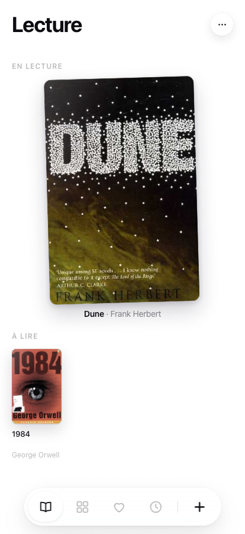
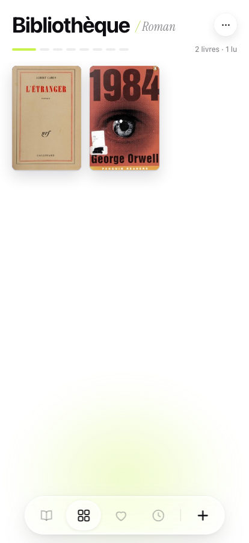
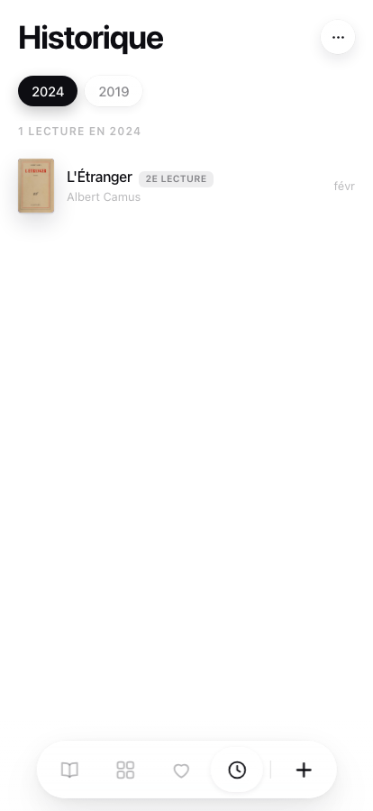

# Bibliothèque

Une app pour suivre ce qu'on lit. Sur papier.

Pas de fil d'actualité, pas de compte à créer. Tu photographies la couverture, le livre entre dans ta bibliothèque, et tu retrouves des années plus tard la trace de ce que tu lisais cet été-là.

**Ta bibliothèque t'appartient.** Tu l'installes chez toi, sur ton hébergement, avec ton mot de passe. Personne d'autre n'y accède — pas même nous.

  
  
  

---

## Installer

Dix minutes, deux comptes gratuits (GitHub et Vercel), aucune carte bancaire.

### En un clic

Vercel te fait créer ta copie, te demande un mot de passe, et fabrique tout le reste. Tu repars avec ta propre adresse et ta bibliothèque synchronisée entre ton téléphone et ton ordinateur.

Prépare ton mot de passe avant de cliquer — il te sera demandé en cours de route, et c'est lui qui protégera ta bibliothèque.

### Ou laisse ton IA le faire

Si tu utilises Claude, ChatGPT ou équivalent, copie-lui ce message :

> Installe cette application pour moi : https://github.com/go-silex/uc-bookworm
> Suis les instructions du fichier INSTALL.md, et pose-moi les questions au fur et à mesure.

Le dépôt contient un guide écrit spécialement pour être lu par une IA : chaque étape, chaque erreur possible et son remède. Tu n'as rien à comprendre, juste à répondre à ce qu'on te demande.

Le détail pas à pas est dans **[INSTALL.md](INSTALL.md)**.

### Pourquoi Vercel et rien d'autre

L'app est du HTML et du JavaScript sans étape de build : GitHub Pages ou Netlify l'afficheraient très bien. Mais ils n'exécutent pas de code serveur, et c'est le serveur qui garde tes livres. Sans lui, chaque navigateur a sa propre bibliothèque, vider le cache efface tout, et aucune sauvegarde n'est possible.

Ça marche magnifiquement pendant six mois, puis on perd deux cents livres sans avoir rien fait de mal. D'où le chemin unique.

---

## Ce que ça fait

**Quatre écrans**, qui glissent horizontalement.

- **Lecture** — ce que tu lis en ce moment, et la pile de ce qui t'attend. Plusieurs livres en cours&nbsp;? Ils sont posés en éventail : glisse vers la droite pour faire tourner la pile, ou touche un livre de derrière pour le ramener devant.
- **Bibliothèque** — tes livres rangés par genre, un chapitre par genre.
- **Favoris** — ceux qui comptent.
- **Historique** — une page par année. C'est là que l'app devient intéressante avec le temps.

**Ajouter un livre.** Tu cherches par titre, ou tu photographies la couverture. L'app lit le code-barres s'il y en a un, sinon elle déchiffre la couverture (voir plus bas). Les couvertures arrivent toutes seules, depuis Open Library et Google Books.

**Cinq étoiles, une fois le livre refermé.** Quand tu touches **Terminé**, la fiche te demande ton avis : une à cinq étoiles, d'un geste. Elles n'apparaissent ni sur un livre à lire ni pendant une lecture — on ne juge pas un livre avant de l'avoir fini. Retouche l'étoile choisie pour effacer l'avis ; l'Historique l'affiche en petit à côté de chaque lecture.

**Une note par livre.** Sous les dates de sa fiche, un bloc à remplir : ce que tu en as pensé, à qui tu l'as prêté, la page à relire. Rien d'autre — pas de champs à remplir.

**Tout se corrige.** Le crayon sur la fiche d'un livre ouvre son édition : titre, auteur, genre, couverture (l'app te propose celles des catalogues), dates de lecture. Tu peux aussi retirer une lecture, ou en ajouter une que tu avais oubliée.

**Les relectures comptent.** Un livre lu trois fois apparaît trois fois dans l'historique, aux trois bonnes dates. C'était le point de départ du projet.

**Ça s'installe comme une app**, sans passer par l'App Store — [voir la dernière étape](#la-dernière-étape--la-mettre-sur-ton-écran-daccueil).

---

## Bien démarrer

**Vider la bibliothèque de démonstration.** L'app arrive avec six livres d'exemple pour que tu voies à quoi ça ressemble. Menu **⋯** en haut à droite → **Vider la bibliothèque**.

**Le scan de couverture** (facultatif) demande une clé Google Gemini, gratuite et sans carte bancaire, à créer sur [aistudio.google.com](https://aistudio.google.com/apikey).

Deux façons de la poser. Dans les réglages Vercel sous le nom `GEMINI_API_KEY` : c'est la bonne, tu le fais une fois et le scan marche sur tous tes appareils. Ou directement dans l'app au premier scan, si tu préfères ne pas y penser tout de suite — l'app t'explique la marche à suivre, mais cette clé-là ne vaudra que pour l'appareil où tu l'as collée.

Sans clé du tout, la recherche par titre fonctionne très bien.

**Ton mot de passe.** Il n'y a pas de « mot de passe oublié » : personne ne peut le retrouver à ta place, note-le quelque part. Tu peux le changer quand tu veux sans rien perdre — Vercel → ton projet → Settings → Environment Variables → `LIBRARY_PASSWORD`, puis redéployer.

**Sauvegarder, quand ta bibliothèque commencera à compter.** [`docs/backup.yml`](docs/backup.yml) est une tâche GitHub prête à l'emploi : elle copie ta bibliothèque dans un dépôt **privé** les 1er et 15 de chaque mois, chez un autre fournisseur que l'app. Git garde chaque version, tu peux remonter à n'importe quelle date. Marche à suivre dans [INSTALL.md](INSTALL.md#étape-6--la-sauvegarde-automatique-recommandé-après-un-an-dusage).

---

## La dernière étape — la mettre sur ton écran d'accueil

Une bibliothèque qu'on doit ouvrir dans un navigateur, on l'oublie. Fais cette étape maintenant, elle prend trente secondes et c'est elle qui transforme le site en app.

**Il n'y a pas d'App Store ici, et il n'y en a pas besoin.** Ton téléphone sait déjà installer un site comme une application — même icône, même plein écran, même comportement. La différence ne se voit pas à l'usage.

### Sur iPhone

1. Ouvre ton adresse **dans Safari** (ça ne marche pas depuis Chrome sur iOS).
2. Appuie sur le bouton **Partager** — le carré avec la flèche vers le haut, en bas de l'écran.
3. Fais défiler et choisis **Ajouter à l'écran d'accueil**.
4. Si l'option **Ouvrir comme** apparaît, choisis **Application**. C'est ce qui supprime la barre d'adresse et donne le vrai plein écran.
5. **Ajouter**, en haut à droite.

L'icône est maintenant sur ton écran d'accueil. Tu peux la déplacer, la ranger dans un dossier, la mettre dans ton dock — Safari n'apparaîtra plus jamais.

### Sur Android

Ouvre l'adresse dans Chrome → menu **⋮** → **Installer l'application** (ou *Ajouter à l'écran d'accueil*).

### Sur ordinateur

Chrome et Edge affichent une petite icône d'installation à droite de la barre d'adresse. Facultatif, mais pratique si tu saisis tes livres depuis ton bureau.

> Le mot de passe est demandé une fois par appareil. Une fois saisi, tu n'y repenses plus : ta bibliothèque se synchronise toute seule entre ton téléphone et ton ordinateur.

---

## Sous le capot

Sept fichiers de code, aucun framework, aucune étape de build.

| | |
|---|---|
| `index.html` | 30 lignes de squelette |
| `app.js` | toute l'application |
| `style.css` | tout le style |
| `glass.js` | l'effet de verre liquide (Chromium uniquement, dégradé ailleurs) |
| `api/library.js` | la synchronisation, côté serveur |
| `api/vision.js` | la reconnaissance de couverture par Gemini, côté serveur — la clé ne passe jamais par le navigateur |
| `sw.js` | le cache des images de couverture, rien d'autre |

**Le modèle de données.** Un livre a un titre, un auteur, un genre, un avis sur 5 facultatif, et une liste de *sessions* de lecture (`startedAt` / `finishedAt`). Tout le reste en découle : le statut se déduit de la dernière session, l'historique est la liste de toutes les sessions terminées.

**La synchronisation.** Le navigateur garde tout en `localStorage` et pousse vers `/api/library`, protégé par un mot de passe unique. Côté serveur, la bibliothèque vit dans un store Vercel Blob privé : on ne la lit qu'en passant par ce mot de passe. Sans serveur configuré, l'API répond `501` et l'app continue en local sans rien dire. Les bibliothèques de deux appareils fusionnent au lieu de s'écraser : les livres se réunissent par titre, les sessions par date de fin. Rien n'est perdu, rien n'est doublé.

---

## English

A reading tracker for paper books. No feed, no account — you deploy your own copy and it's yours.

**Install:** click the Vercel button above (two free accounts, ~10 min, no credit card), or hand the repo to your AI assistant with *"install this for me, follow INSTALL.md"*. Step-by-step instructions live in **[INSTALL.md](INSTALL.md)**.

Vercel is the only supported target, on purpose. The app is plain static files and would render fine on GitHub Pages — but those hosts run no server code, and the server is what keeps your books. Without it every browser holds its own separate library, clearing the cache wipes it, and no backup is possible.

**Note:** the interface is in French. The code is plain vanilla JS with no build step, so translating it means editing string literals in `app.js` — contributions welcome.

**How it works:** four swipeable views (reading, library by genre, favourites, history by year). Books are added by title search or by photographing the cover — barcode first, then a Gemini vision fallback if you supply a free API key. Covers are fetched from Open Library and Google Books. Finished books can be rated out of five stars — never before you've finished them. Re-reads are first-class: each reading session is stored separately, so a book read three times shows up three times in your history.

**Data:** stored in `localStorage` and synced to your own private Vercel Blob store behind a single password you choose. Nobody else can read it — the code is public, your library is not.

**Last step — put it on your home screen.** No App Store needed. On iPhone, open your URL **in Safari** → *Share* → *Add to Home Screen* → if asked, pick **Open as: Application** → *Add*. On Android, Chrome → **⋮** → *Install app*. It then behaves exactly like a native app, full screen, its own icon.

---

## Contribuer

Les issues et les pull requests sont bienvenues. Le projet est volontairement minimal : pas de dépendance côté navigateur, pas de build, pas de framework. Une contribution qui ajoute un `node_modules` au client sera probablement refusée avec le sourire.

Quelques pistes ouvertes : export / import JSON, traduction de l'interface, thème sombre.

## Licence

MIT — voir [LICENSE](LICENSE).

Construit par [Unkillable Companies](https://unkillablecompanies.com).
